<div align="center">



<br>

[](https://www.linkedin.com/in/cherrati-yasmine-a15159381)

</div>

<br>

```
name       cherrati yasmine
study      software engineering
where      USTHB
year       3rd year (ing3)
into       interactive, full-of-life websites
loves      random ideas turning into real pages
learning   databases, c++
off duty   crochet, vlog editing, youtube
```

<br>

### 🌸 right now
- learning how to manipulate databases
- learning c++

<br>

### 🌷 my stats
<div align="center">


</div>


<br>


